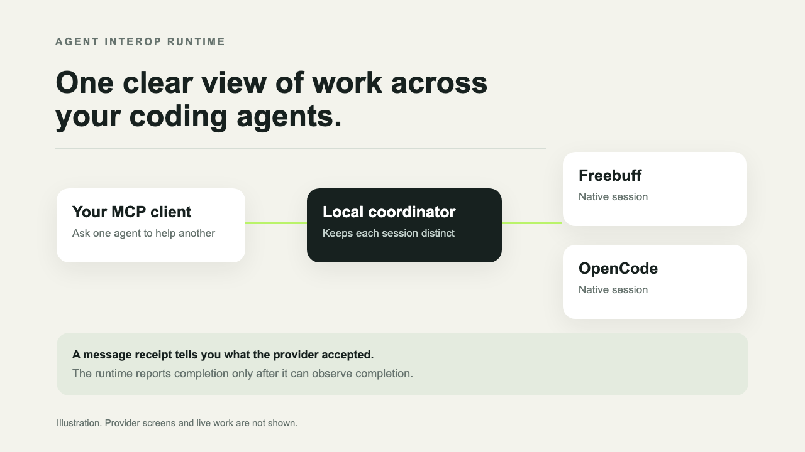
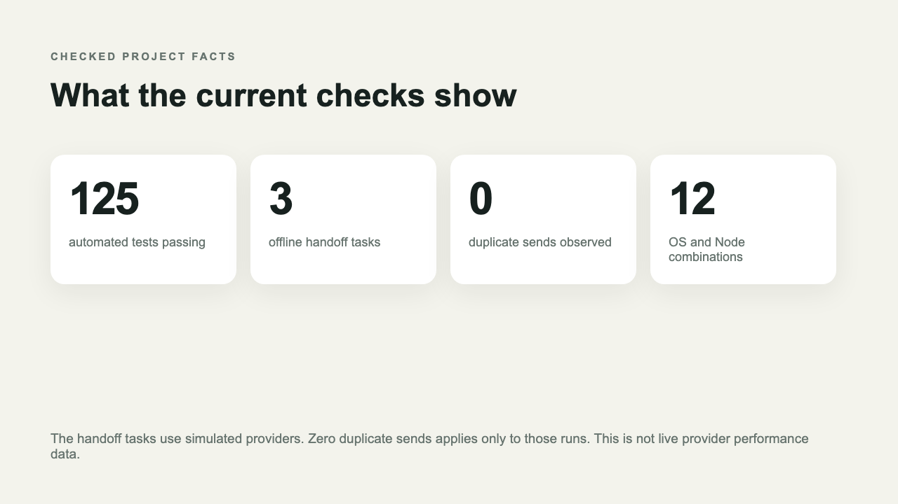

# Agent Interop Runtime

Your coding agents already know how to work, and Agent Interop Runtime helps them share a task while each one keeps its own identity, account, and working environment.

Connect a local MCP client to the runtime, and it will find the coding agents installed on your computer so you can choose a session, send it work, follow its progress, and pass a result to another session. Each provider still uses its own account, permissions, history, and project access, so the runtime coordinates the work without merging separate environments.

Think of it as a traffic desk for coding agents, because it shows which session received a task, records the updates that provider sends back, and keeps the result of each check in one place without turning separate conversations into a shared chat.



[Watch the short illustrated tour](docs/media/agent-interop.mp4)



These pictures are illustrations, so they explain the workflow and available measurements but do not show a live provider session.

## What happens when you send work

The runtime sends your message to the provider session you selected, and the receipt may confirm that the provider accepted it; however, acceptance only confirms delivery to the provider and does not mean the agent finished the task. The runtime reports completion only after it observes a result from that session.

The same rule applies when delivery is uncertain, because a network failure may happen after the provider accepted your message but before the runtime received confirmation. In that case the runtime marks delivery as unknown and does not silently send the prompt again, which avoids repeating work that may already be underway.

## What it can do

Find supported provider sessions on your computer, so you can see which local tools are available before choosing where to send work.

Create or resume sessions when the selected provider supports those actions, and use the provider report to check which controls are available in your setup.

Send work, request cancellation, read progress, and collect a provider diff when the selected provider supports those features.

Keep shared work notes, handoffs, evidence, reviews, and cooperative resource claims so participating sessions can coordinate around the same task.

Run local checks inside a named workspace when you explicitly enable verification, and review the configured programs before trusting them with a project.

Read small text files inside an approved project folder, while common credential files are blocked, credential shaped text is redacted, and binary files are refused.

Provider features differ, so the doctor report shows what each installed provider can do; finding a provider alone does not confirm its sign in status or whether it is ready to accept work.

## What it does not do

It does not merge provider accounts or histories, and each session remains subject to its provider's own settings.

It does not bypass a login, consent prompt, or permission request, so you must complete those steps through the provider itself.

It does not give an agent access to a provider that is not installed on the computer running the runtime, nor does it replace that provider's own application.

It does not sandbox commands, because verification runs the programs you configure with the access available to your account, so use it only with work and commands you trust.

Resource claims coordinate agents that use this runtime, but they cannot stop another program from editing the same files outside the runtime.

## Providers

Freebuff Desktop uses its local app connection, and writes require a current launch check before work is sent; Freebuff CLI instead uses a managed terminal session.

OpenCode uses its local server, which the runtime may start on loopback when needed, and requests that may change work are never replayed after an uncertain network result. Each session remains tied to the server that exposed it, so switching servers does not silently redirect existing work.

Codex uses the Codex app server, while Claude Code and Cursor use their supported Agent Client Protocol commands.

The available features depend on the provider version, local setup, and account state, and most protocol checks use simulated providers rather than live sessions. Check the provider on the computer that will run the MCP server before relying on it for live work.

## Choose the tools your client sees

The runtime starts with a focused set of nine tools, so a new MCP connection can find providers, inspect and control sessions, read events, and cancel or resume work without loading the larger coordination catalog. You can choose a larger set when your work needs shared conversations, evidence, handoffs, or Freebuff specific controls, and you can keep the original 0.3.x names while migrating an existing client.

| Profile | Tools | Use it when |
| --- | ---: | --- |
| `minimal` | 9 | You want the recommended starting set for provider sessions. |
| `core` | 30 | You also need shared conversations, work records, handoffs, reviews, evidence, and claims. |
| `freebuff` | 16 | You mainly work with Freebuff projects and threads. |
| `full` | 49 | You need the modern names for every supported feature. |
| `legacy` | 52 | An existing MCP client still calls the original 0.3.x tool names. |

The modern profiles use predictable verb first names, and related progress operations have been combined so one tool can read a snapshot or wait for updates. The legacy profile preserves the previous names during migration, while [the migration guide](docs/migration-1.0.md) maps each older tool to its new name or replacement.

Choose a profile on the server command, or set `INTEROP_TOOLS_PROFILE` when your client configuration cannot pass an argument.

```sh
npx -y agent-interop-runtime@1.0.1 serve --profile minimal
npx -y agent-interop-runtime@1.0.1 serve --profile core
npx -y agent-interop-runtime@1.0.1 serve --profile freebuff
npx -y agent-interop-runtime@1.0.1 serve --profile full
npx -y agent-interop-runtime@1.0.1 serve --profile legacy
```

Read only mode removes tools that change provider or coordination state, and it can be enabled by setting `INTEROP_READ_ONLY=1` in the server environment.

## Install

Use Node 20 through Node 26, and install the current major release with npm or pnpm before checking which providers are available.

```sh
npm install --global agent-interop-runtime@1
agent-interop-runtime doctor
```

You can also use the source checkout when you are changing the project, and its build runs the same TypeScript compiler used by the release workflow.

```sh
git clone https://github.com/Praket7/agent-interop-runtime.git
cd agent-interop-runtime
pnpm install
pnpm build
node dist/src/cli.js doctor
```

## Connect a local MCP client

The runtime talks to provider apps and tools installed on the same computer, so the recommended connection is a local MCP server over standard input and output. Start with the setup command for your client, and restart or reload that client after changing its configuration.

### Codex

The installer adds or repairs the local Codex entry, backs up the existing configuration before changing it, and preserves unrelated settings.

```sh
npx -y agent-interop-runtime@1.0.1 install --write
```

### Cursor

The Cursor installer writes a project independent entry in your user configuration, and `--project` can be added when you want the connection only in the current project.

```sh
npx -y agent-interop-runtime@1.0.1 cursor-setup --write
```

### Claude Code

Claude Code can launch the local server directly, and the command below starts with the recommended nine tools.

```sh
claude mcp add --transport stdio agent-interop-runtime -- npx -y agent-interop-runtime@1 serve --profile minimal
```

### OpenCode

Add the following entry to your OpenCode configuration, and the local process will expose the same focused tool set.

```json
{
  "$schema": "https://opencode.ai/config.json",
  "mcp": {
    "agent-interop-runtime": {
      "type": "local",
      "command": ["npx", "-y", "agent-interop-runtime@1", "serve", "--profile", "minimal"],
      "enabled": true
    }
  }
}
```

Other MCP clients can launch the same `serve` command through their local server configuration, and the provider applications must be available on the computer running the runtime. HTTP mode can support a deliberate remote setup, but it needs authentication and network protection because session identifiers do not replace access control.

## Current evidence

Automated tests and offline benchmarks check the tool behavior with simulated providers, and those results do not contact live agents, measure speed, or estimate provider cost. GitHub CI checks three operating systems against four supported Node versions, for twelve combinations.

Earlier local checks observed a response from Freebuff GLM 5.3 Flash, and OpenCode Big Pickle accepted a prompt, although completion was not observed in that session. Those observations apply only to the specific sessions tested, so they do not establish general provider support.

## Run checks

```sh
pnpm typecheck
pnpm test
pnpm lint
pnpm mcp:validate
pnpm schema:check
pnpm bench:check
pnpm audit --prod --audit-level=high
npm audit --prefix media/remotion --audit-level=high
pnpm pack:check
```

Read [the provider guide](docs/adapters.md), [the plain language architecture guide](docs/architecture.md), [the compatibility notes](docs/compatibility.md), [the 1.0 migration guide](docs/migration-1.0.md), and [troubleshooting](docs/troubleshooting.md) for setup and behavior details.

## Safety and privacy

The local standard input and output server is the simplest setup, while HTTP mode binds to loopback by default and requires a bearer token. Remote access requires an explicit setting and network protection, because session identifiers do not replace authentication.

Project file reads stay inside the selected project folder, and common credential files are denied while text is checked against common credential patterns. These checks cannot detect every secret, so keep sensitive values out of files an agent can read.

Verification is off by default, but when enabled it runs configured programs without a shell and checks that the working folder stays inside the named workspace. Child programs are not sandboxed, so they retain the access granted by your account.

## Help improve it

Use `doctor` before sending work, and when reporting a problem include the provider name, version, operating system, the action you tried, and whether the provider accepted the task or returned a completed result. Leave private prompts and credentials out of reports.

The project welcomes reproducible compatibility reports and code contributions, especially when they explain what happened on a specific provider version and computer.
